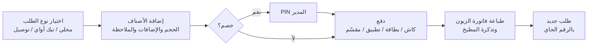
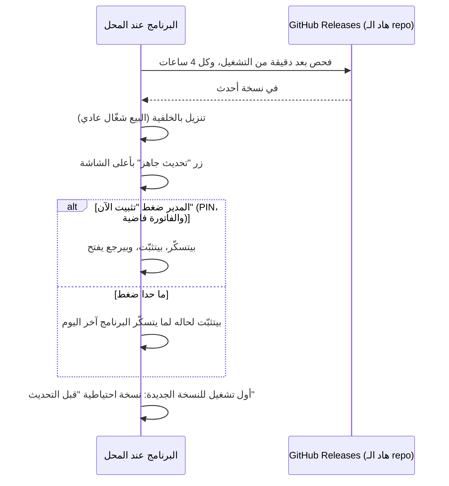

# 🍕 Pizza POS: نقطة بيع لمحلات البيتزا

برنامج نقطة بيع (POS) لمحل بيتزا، **عربي بالكامل من اليمين لليسار**، بيشتغل على **ويندوز** بشاشة لمس، و**بدون إنترنت**.
بيغطّي يوم المحل من أول طلب لإغلاق اليوم: البيع، الدفع، طباعة فاتورة الزبون وتذكرة المطبخ، التوصيل، الخصومات، التقارير، والنسخ
الاحتياطي. وبيحدّث حاله لحاله لما تنزل نسخة جديدة.

> هاد الـ repo للنسخ الجاهزة للتثبيت والتحديثات بس. الكود المصدري خاص.

**⬇️ [تنزيل آخر نسخة](../../releases/latest)**: الملف `Pizza-POS-Setup-<الرقم>.exe`

---

## الميزات

| | الميزة | شو بتعمل |
|---|---|---|
| 🧾 | **شاشة البيع** | تصنيفات على اليمين، الأصناف بالنص، الفاتورة على اليسار. محلي / تيك أواي / توصيل، تعليق طلب واسترجاعه، بحث عن صنف |
| 🍕 | **الأحجام والإضافات** | سعر لكل حجم، إضافات مدفوعة، كمية، وملاحظة للمطبخ |
| 💵 | **الدفع** | كاش / بطاقة / تطبيق دفع، مبالغ سريعة، لوحة أرقام، حساب الباقي، ودفع مقسّم |
| 🖨️ | **الطباعة** | فاتورة الزبون وتذكرة المطبخ تلقائيًا بعد الدفع. طابعات حرارية 80 أو 58 مم (شبكة، USB، أو تعريف ويندوز) |
| 🛵 | **التوصيل** | اسم الزبون وهاتفه وعنوانه، رسوم التوصيل، وبيتذكّر الزبون من رقم هاتفه |
| 🏷️ | **الخصومات** | نسبة أو مبلغ، بحد أقصى، وبموافقة المدير |
| ↩️ | **الإلغاء** | إلغاء طلب أو صنف من "طلبات اليوم" مع السبب وموافقة المدير |
| 📊 | **التقارير** | تقرير اليوم، إغلاق اليوم (Z) ونسخة (X)، تقرير حسب الساعة، وتقارير لفترة |
| 🔐 | **PIN المدير** | بيحمي الإعدادات والخصم والإلغاء وإغلاق اليوم |
| 👥 | **الكاشيرية والورديات** | اختيار الكاشير عند الفتح، وكل طلب مربوط بكاشير (اختياري) |
| ⭐ | **نقاط الولاء** | نقاط للزبون برقم هاتفه، واستبدالها بخصم (اختياري) |
| 💾 | **النسخ الاحتياطي** | نسخة تلقائية كل يوم، ونسخة قبل كل تحديث، واسترجاع بضغطة |
| 🔄 | **التحديث التلقائي** | بينزّل النسخ الجديدة بالخلفية، وبيثبّتها لما تسكّر البرنامج |
| 🧩 | **معياري** | أي ميزة بتنطفي أو بتشتغل من صفحة "الميزات" فورًا، بدون إعادة تشغيل وبدون ما تنحذف بيانات |

---

## صور من البرنامج

الصور كلها من البرنامج نفسه، بدقة 1366×768 وبمنيو تجريبي.

| اختيار الحجم والإضافات | الدفع |
|---|---|
|  |  |
| السعر بيتحدّث مع الحجم والإضافات والكمية | المطلوب، المستلم، الباقي، مبالغ سريعة |
| **طلب توصيل** | **الخصم** |
|  |  |
| بيانات الزبون فوق الفاتورة ورسوم التوصيل بالمجموع | نسبة أو مبلغ، وبيطلب PIN المدير |
| **طلبات اليوم** | **تقرير اليوم** |
|  |  |
| إعادة طباعة، إلغاء، واسترجاع الطلبات المعلّقة | حسب طريقة الدفع ونوع الطلب، الأكثر مبيعًا، إغلاق اليوم |
| **فاتورة الزبون المطبوعة** | **تذكرة المطبخ** |
|  |  |
| شعار المحل، الأصناف، الدفع والباقي | بدون أسعار، بخط كبير، مع الإضافات والملاحظات |
| **الأصناف والأسعار** | **الطابعات** |
|  |  |
| سعر لكل حجم، متوفر أو خلصان، والتعديل بيبيّن فورًا | معاينة حيّة للفاتورة، وطباعة تجريبية |
| **النسخ الاحتياطي** | **PIN المدير** |
|  |  |
| تلقائي كل يوم، أو "نسخة احتياطية الآن"، واسترجاع | قبل أي عملية حساسة |
| **صفحة الميزات** | **نقاط الولاء** |
|  |  |
| شغّل أو اطفي أي ميزة، وصدّر أو استورد الإعدادات | رصيد الزبون على الفاتورة واستبدال النقاط |

---

## آلية عمل البرنامج

### الطلب من أوله لآخره

1. **الكاشير بيختار نوع الطلب.** بالتوصيل بيكتب رقم الهاتف، والبرنامج بيعبّي اسم الزبون وعنوانه إذا كان مسجّل قبل.
2. **بيضيف الأصناف من التصنيفات.** البيتزا بتفتح نافذة الحجم والإضافات، والمشروبات والحلويات بتنضاف بضغطة.
3. **بيضغط "دفع"**، بيختار طريقة الدفع، وبيكتب المبلغ المستلم، والبرنامج بيحسب الباقي.
4. **"دفع وطباعة"** بيطبع فاتورة الزبون وتذكرة المطبخ، وبيفتح طلب جديد فاضي بالرقم الجاي.
5. **طلب مش جاهز للدفع؟** "تعليق الطلب" بيحفظه، وبترجعله من "طلبات اليوم".

### آخر اليوم

- **"تقرير اليوم"** بيعرض المبيعات، وعدد الطلبات، والتوزيع حسب طريقة الدفع ونوع الطلب، والأصناف الأكثر مبيعًا، والكاش
  المفروض يكون بالدرج.
- **"إغلاق اليوم"** (بـ PIN المدير) بيطبع تقرير Z، وبيقفل طلبات اليوم، وبيبلّش ترقيم جديد لليوم الجاي.
- **اليوم التجاري بيخلص الساعة 4 الفجر**، فطلبات بعد نص الليل بتنحسب على نفس اليوم.

### البيانات والنسخ الاحتياطي

- كل البيانات **على جهاز المحل** بملف قاعدة بيانات واحد. ما في سيرفر وما في اشتراك، والبرنامج بيشتغل بدون إنترنت.
- **نسخة احتياطية تلقائية كل يوم** (بيحتفظ بآخر 14 نسخة)، ونسخة **قبل كل تحديث**.
- الاسترجاع من الإعدادات ← "النسخ الاحتياطي"، أو من ملف على فلاشة.

### التحديث التلقائي

- بدون إنترنت، الفحص بيفشل بهدوء وبيرجع يجرّب لحاله، والبيع ما بيتأثّر.
- البرنامج بيتأكد من سلامة الملف المنزّل (sha512) قبل التثبيت.

---

## التثبيت

1. نزّل `Pizza-POS-Setup-<الرقم>.exe` من [Releases](../../releases/latest).
2. شغّله. إذا طلع تحذير ويندوز (SmartScreen): **More info** ← **Run anyway**. التحذير بيطلع لأن الملف مش موقّع رقميًا،
   وبيطلع مرة وحدة بس عند التثبيت الأول.
3. **خلّي مجلد التثبيت الافتراضي** زي ما هو. إذا ثبّته تحت `Program Files`، كل تحديث بيحتاج موافقة مدير ويندوز.
4. افتح البرنامج، وروح على الإعدادات:
   - **غيّر PIN المدير** من "الأمان".
   - عبّي اسم المحل وعنوانه وشعاره من "معلومات المحل".
   - عدّل المنيو والأسعار من "الأصناف والأسعار".
   - اختار الطابعة من "الطابعات" واعمل "طباعة تجريبية".

**المتطلبات:** ويندوز 10 أو 11 (64-bit). شاشة لمس 1366×768 أو أكبر (بيشتغل كمان بالماوس والكيبورد). طابعة حرارية
ESC/POS اختيارية.

**مكان البيانات:** `%APPDATA%\Pizza POS\data\` للقاعدة، و`%APPDATA%\Pizza POS\backups\` للنسخ الاحتياطية.

---

## التقنيات

Electron · React · TypeScript · SQLite · طباعة ESC/POS raster للعربي · electron-updater

---

© جميع الحقوق محفوظة. هاد الـ repo بيوزّع نسخ التثبيت بس، وما فيه ترخيص لإعادة استعمال البرنامج أو الكود.

